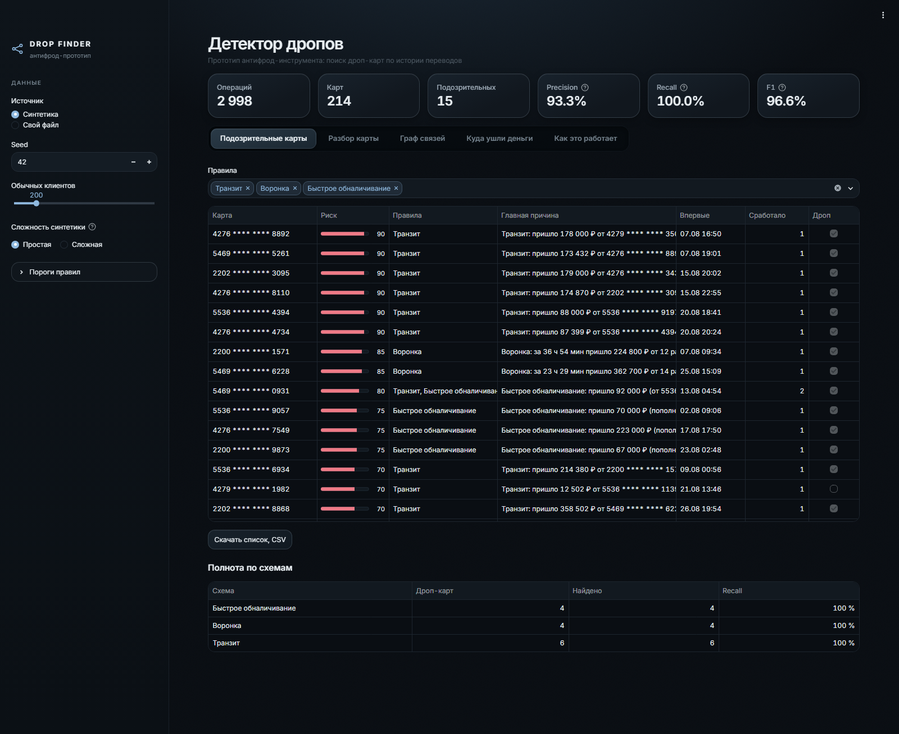
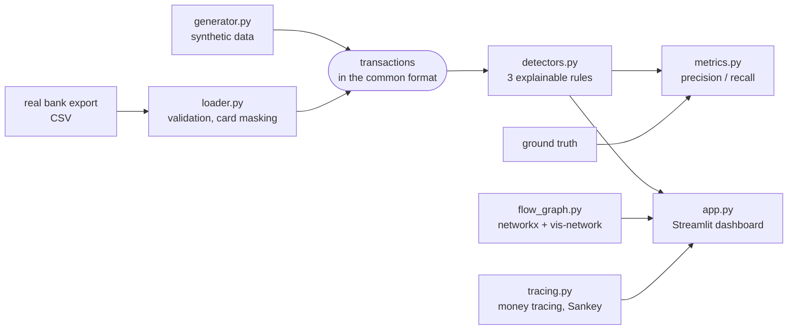
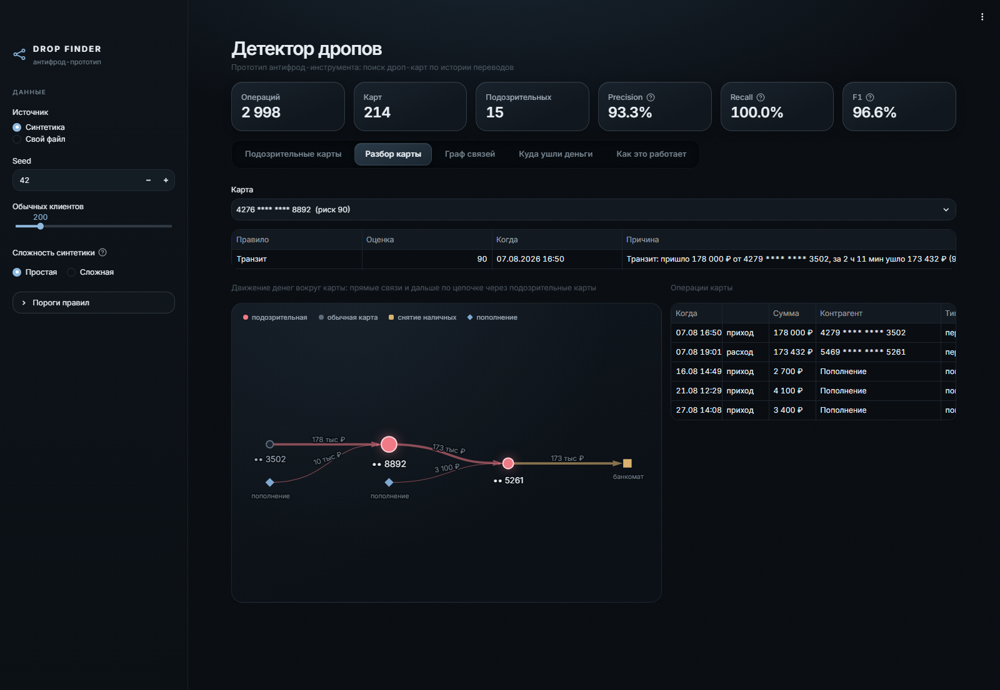
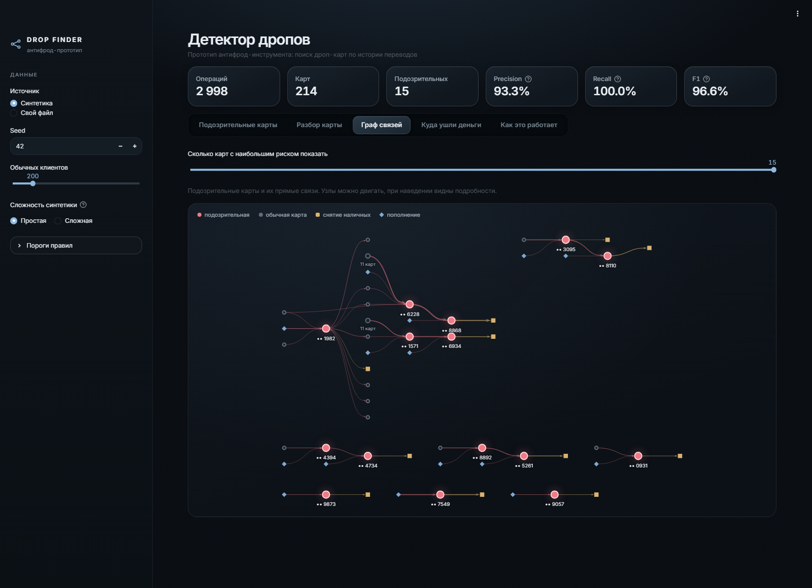
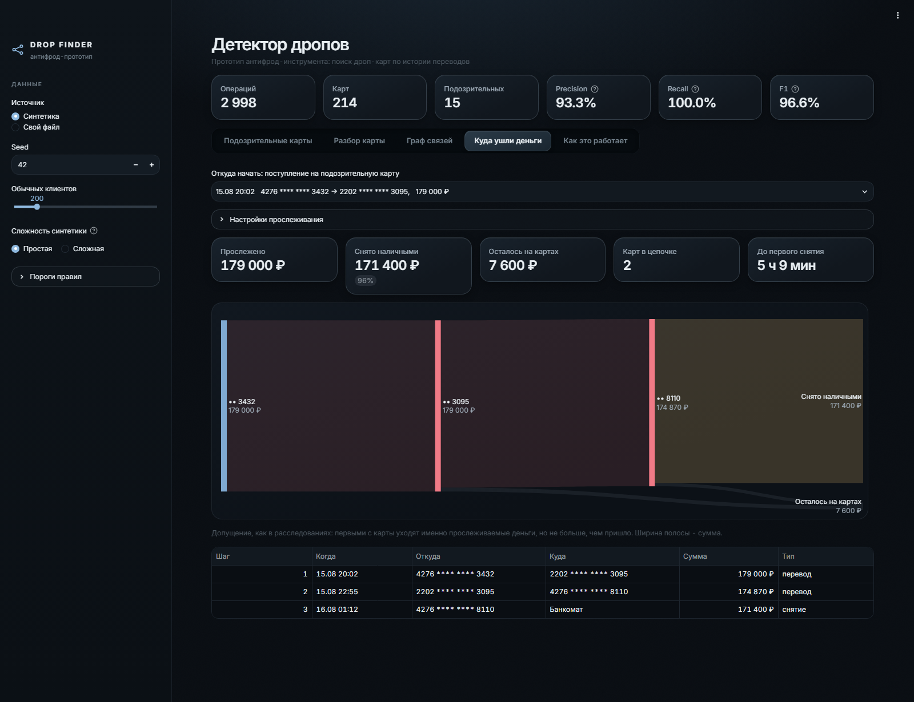

# drop_finder

[](https://drop-finder.streamlit.app)
[](https://github.com/PachkaKofe04/drop_finder/actions/workflows/tests.yml)

[](https://github.com/astral-sh/ruff)
[](LICENSE)

Prototype anti-fraud tool for detecting money mule ("drop") cards from card transfer history.

A money mule card is used to receive stolen money and pass it on: to other cards or out through an ATM.
drop_finder looks for the patterns such cards leave in transaction data.

What is inside: a synthetic data generator with hidden mule schemes at two difficulty levels, a loader for real bank exports,
explainable rule-based detection with accuracy metrics, money tracing from a victim to the ATM,
and a Streamlit dashboard with an interactive money flow graph.

**Live demo:** [drop-finder.streamlit.app](https://drop-finder.streamlit.app) (synthetic data only).
The free hosting puts the app to sleep when nobody has opened it for a while. If you see a sleeping page,
press "Yes, get this app back up!" and wait about 30 seconds.



## Quick start

Requires Python 3.11.

```
python -m venv .venv
.venv\Scripts\activate
pip install -r requirements.txt
python generator.py --seed 42
python detectors.py data/transactions.csv --truth data/ground_truth.csv
streamlit run app.py
```

On Linux / macOS activate the environment with `source .venv/bin/activate`.

## Project structure

| File | Purpose |
|---|---|
| `generator.py` | Synthetic transactions with hidden mule schemes |
| `loader.py` | Loads and validates any CSV (synthetic or real) into the common format |
| `detectors.py` | Three detection rules, one row per suspicious card with a reason |
| `metrics.py` | Precision / recall against the ground truth, benchmark over many seeds |
| `flow_graph.py` | Money flow graph: networkx for the structure and layout, vis-network for the picture |
| `tracing.py` | Money tracing: where the money from one operation went, Sankey diagram |
| `app.py` | Streamlit dashboard |
| `theme.py`, `assets/app.css`, `.streamlit/config.toml` | Dark theme: one palette for the dashboard, the graph and the Sankey diagram |
| `tests/` | pytest suite |
| `data/` | CSV files, not tracked by git |

## Architecture



Every component after the loader works with one data format, so the same detection code runs
on synthetic data and on real exports.

## Data format

Every other part of the project works with this format only, whatever the data source.

| Column | Meaning |
|---|---|
| `datetime` | Operation time, `2026-08-01 14:30:00` |
| `sender_card` | Sender card, `EXTERNAL` for top-ups |
| `receiver_card` | Receiver card, `ATM` for cash withdrawals |
| `amount` | Amount in rubles |
| `op_type` | `transfer`, `cash_withdrawal`, `top_up` (`other` if not recognized in real data) |

Cards in synthetic data are masked: `2202 **** **** 4821`.

## Synthetic data

```
python generator.py --seed 42 --clients 200
```

The same seed always gives the same files. Output:

- `data/transactions.csv` - 30 days of operations: ~200 regular clients
  (salaries, transfers to friends, ATM withdrawals) with mule schemes hidden among them;
- `data/ground_truth.csv` - mule cards and their scheme, to measure detection accuracy.

Hidden schemes:

| Scheme | Pattern |
|---|---|
| `transit` | Victim -> mule 1 -> mule 2 -> ATM. Each hop within 1-3 hours, amounts almost equal |
| `funnel` | 8-15 different cards send money to one card within 1-2 days, then it moves on |
| `fast_cashout` | A card receives a large amount and withdraws almost all of it within an hour |

Regular clients also include legitimate look-alikes, so that a detector has something to get wrong:
group money collections (many small transfers to one card) and cash withdrawals right after payday.

### Hard mode

```
python generator.py --seed 42 --difficulty hard
```

In the default easy mode every scheme stays inside the detection thresholds by construction:
transit hops take 1-3 hours against a 6-hour window, funnels have 8-15 senders against a minimum of 8.
That is why recall is 100% there. Hard mode keeps the easy data unchanged and adds schemes
that stay just outside the rules, the way real mules adapt:

| Scheme | Pattern | Slips past |
|---|---|---|
| `split` | Victim -> hub -> 3-4 mules -> ATM. The hub holds the money for 7-24 hours, the mules withdraw it under a daily limit | transit (6-hour window), fast cash-out (1-hour window) |
| `warmup` | 2-4 weeks of ordinary activity, then a large amount is withdrawn in parts over a day | fast cash-out, transit |
| `p2p` | A "crypto seller" gets paid by different people once every 7-16 hours for 5-10 days and cashes out every 1-2 days | funnel (never 8 senders within 48 hours) |

It also adds two more legitimate look-alikes:

- a large purchase paid from one's own second card: the money arrives and 95-100% of it goes to the seller
  within 1-4 hours, exactly like transit;
- a self-employed tutor: payments from many different people all month, like a P2P mule,
  but with round amounts and returning customers, and the money stays on the card.

## Real data

`loader.py` accepts real bank exports in CSV:

- UTF-8 or Windows-1251, separated by `,`, `;` or tab;
- columns are matched by name, including Russian ones (`Дата операции`, `Сумма`, ...);
  other names can be mapped explicitly;
- dates like `2026-08-01 14:30:00` or `01.08.2026 14:30`, amounts like `1 234,56 руб.`;
- operation types are recognized by keywords (`Перевод`, `Снятие наличных`, `Пополнение`);
- rows that cannot be parsed are dropped with a warning.

Check a file:

```
python loader.py path/to/export.csv
```

Use it from code:

```python
from loader import load_transactions

df, warnings = load_transactions(
    "export.csv",
    column_map={"datetime": "Дата проводки", "amount": "Сумма в руб."},
    datetime_format="%d/%m/%Y %H:%M",  # only if the format is unusual
)
```

### Card numbers

Full card numbers never leave the loader. They are masked and tagged with a keyed hash:
`2202 **** **** 4821 #a1b2c3`. The tag keeps different cards with the same first and last
digits apart, and the number cannot be recovered from it without the key.

By default the key is random for each run. To get the same tags across runs,
set the `DROP_FINDER_SECRET` environment variable.

Card tokens or internal IDs are the best input: they are kept as is.
Already masked numbers (`2202 **** **** 4821`) are kept too, but different cards
with the same visible digits will then be merged into one.

### Handling real data

The `data/` folder is excluded from git. Do not commit or share real exports,
and follow your organization's rules for personal and payment card data.

## Detection

```
python detectors.py data/transactions.csv --truth data/ground_truth.csv
```

Three explainable rules. Thresholds live in `detectors.Rules` and are deliberately looser
than the generator's parameters, so the detector is not tuned to its own synthetic data.

| Rule | Fires when |
|---|---|
| `transit` | A transfer of 10 000+ arrives and 90-100% of it leaves the card within 6 hours. Cards passing money to each other are linked into chains with networkx |
| `funnel` | 8+ different senders within 48 hours, 50 000+ collected, and 80%+ of it leaves within the next 24 hours |
| `fast_cashout` | 30 000+ arrives and 80%+ of it is withdrawn in cash within an hour |

Every flagged card comes with a human-readable reason (in Russian), for example:

> Транзит: пришло 88 000 ₽ от 5536 \*\*\*\* \*\*\*\* 9197, за 1 ч 42 мин ушло 87 399 ₽ (99%) на 4276 \*\*\*\* \*\*\*\* 4734, цепочка из 2 транзитных карт

The risk score orders the list, it is not a probability: transit 70 (90 in a chain of transit cards),
fast cash-out 75, funnel 85, plus 5 for each additional rule. Without `--truth` the command works
on real exports and just saves the list to `data/suspicious.csv`.

### Results on synthetic data

`python metrics.py --seeds 20` and `python metrics.py --seeds 20 --difficulty hard`

| | Precision | Recall | F1 |
|---|---|---|---|
| Easy, seed 42 | 93.3% | 100% | 96.6% |
| Easy, mean over 20 seeds | 94.6% | 100% | 97.1% |
| Easy, worst seed | 87.5% | 100% | 93.3% |
| Hard, seed 42 | 75.0% | 53.6% | 62.5% |
| Hard, mean over 20 seeds | 74.7% | 51.0% | 60.6% |
| Hard, worst seed | 70.0% | 48.3% | 57.1% |

In easy mode all 17 false positives over 20 seeds come from the transit rule: a regular client receives
10-53 thousand rubles and happens to send about the same amount within a few hours. The legitimate look-alikes
(group collections, cash after payday) produce none. False positives get the lowest risk score (70),
while real transit chains get 90.

**Caveat:** the rules and the generator were written by the same author, so the easy numbers are optimistic.
Hard mode shows how fast they drop once mules behave a little differently. Real data is noisier still,
and the thresholds will need tuning on it.

### What the rules miss

Recall by scheme in hard mode, 20 seeds:

| Scheme | Mule cards | Caught | Recall |
|---|---|---|---|
| `transit` | 120 | 120 | 100% |
| `funnel` | 80 | 80 | 100% |
| `fast_cashout` | 80 | 80 | 100% |
| `split` | 179 | 0 | 0% |
| `warmup` | 60 | 0 | 0% |
| `p2p` | 40 | 5 | 12.5% |

- `split`: no card passes on 90% of the money within 6 hours or withdraws 80% within an hour.
  Money tracing still follows such a chain to the ATM (with seed 42, 94% of the victim's money
  is withdrawn in cash through 4 cards), but tracing has to start from a flagged card.
- `warmup`: the cash-out is spread over a day, so it is neither fast nor transit. The weeks
  of ordinary history do not matter to the rules at all: they look at single events,
  not at a change in how a card behaves.
- `p2p`: payments come too rarely for the funnel window. The 5 caught cards were caught by the transit
  rule by chance, when a cash withdrawal happened to match one payment.

There are 97 false positives over 20 seeds. 80 of them are the own-second-card look-alike: the transit rule
flags every one of them. The other 17 are the same regular clients as in easy mode. The self-employed
look-alike produces none, because no rule looks at many senders over a long period. A P2P detector
would have to, and this look-alike is there to keep it honest.

The rules were deliberately not tuned to hard mode. It is a baseline for the next detector to beat.

Performance: about 6 seconds for 1 million operations. Operations are indexed by (card, time) keys
and searched with binary search instead of row-by-row loops.

## Dashboard

```
streamlit run app.py
```

- data source: synthetic data (seed, number of clients, easy or hard mode) or your own CSV
  with an optional ground truth file;
- rule thresholds in the sidebar, the list and the metrics update immediately;
- suspicious cards with risk, rules and reasons, CSV download;
- with a ground truth: recall for each scheme and the list of missed mule cards;
- card drill-down: every rule hit, the card's operations and an interactive money flow graph
  that follows the chain through other suspicious cards;
- network view of all suspicious cards and their direct links;
- money tracing (see below).

In the graphs money flows from left to right: where it came from, which cards it passed, where it was
withdrawn. The layout is computed in Python, so the picture is the same every time it opens.
Many ordinary cards linked to one card in the same way, such as the victims of a funnel,
are folded into one node like "12 cards" with the full list in its tooltip.
Colors carry meaning only: red is a flagged card, violet a mule the rules missed, gold a cash withdrawal,
blue money coming from outside.





### Money tracing

Pick a transfer into a suspicious card, for example a victim's payment, and see where that money went:
through which cards, how much was withdrawn in cash and how much is still on cards,
and how soon the cash-out started.

The tracer follows the receiving card's outgoing operations in time order and assumes that the traced
money leaves first, but never more than arrived (a common conservative assumption in investigations).
It stops at an ATM, after a time horizon (72 hours per card by default) or after a number of steps,
never counts the same operation twice and keeps the total exactly equal to the traced amount.

With seed 42, the share of a victim's money that ends up withdrawn in cash is 95.8-98.5% in transit
chains, 100% in funnels and 91.3-94.9% in fast cash-outs.



**Demo mode.** Uploading files is only available when the app is opened on `localhost`.
A public deployment, such as Streamlit Community Cloud, works on synthetic data only,
so that nobody uploads real customer data to a public server. To allow uploads on your own
server, set `DROP_FINDER_ALLOW_UPLOAD=1`.

## Tests

```
pip install -r requirements-dev.txt
pytest --cov
ruff check .
```

GitHub Actions runs the same on every push: lint, tests and coverage (the build fails below 90%).

The tests check that every hidden scheme matches its definition in both modes, that easy mode stays
exactly the same (the numbers above depend on it) and hard mode only adds to it, that the legitimate
look-alikes match their descriptions, that the loader handles messy real exports
(Windows-1251, `;`, Russian headers, mixed date formats, currency in amounts, full card numbers),
that each detection rule fires on its pattern and stays silent on hand-made near misses,
that money tracing never loses or double-counts money (splits, cycles, horizons, step limits),
and that the dashboard builds without errors and reacts to its settings (Streamlit AppTest).

## License

MIT, see [LICENSE](LICENSE).
